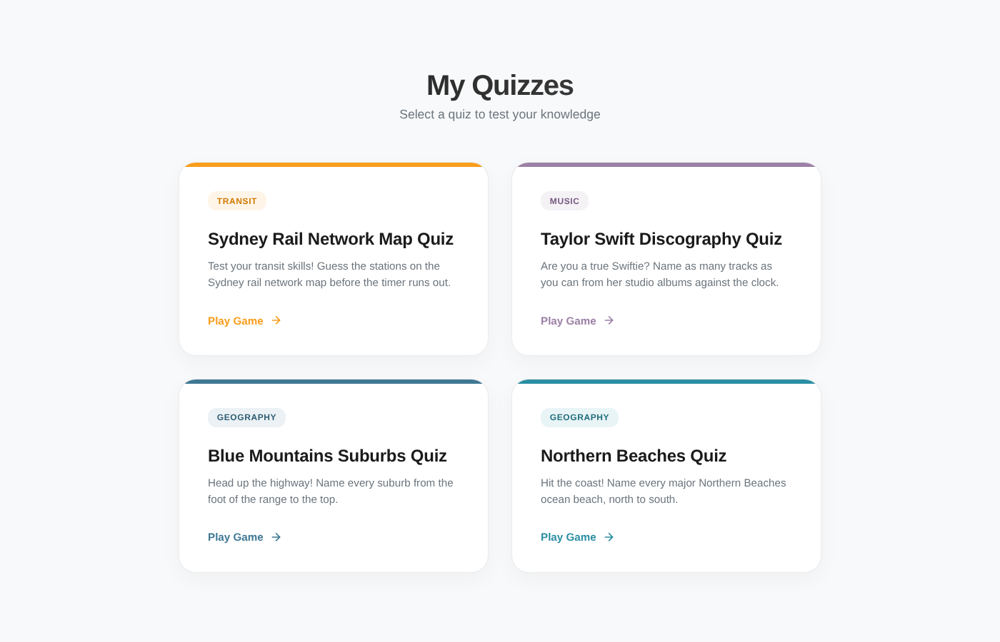
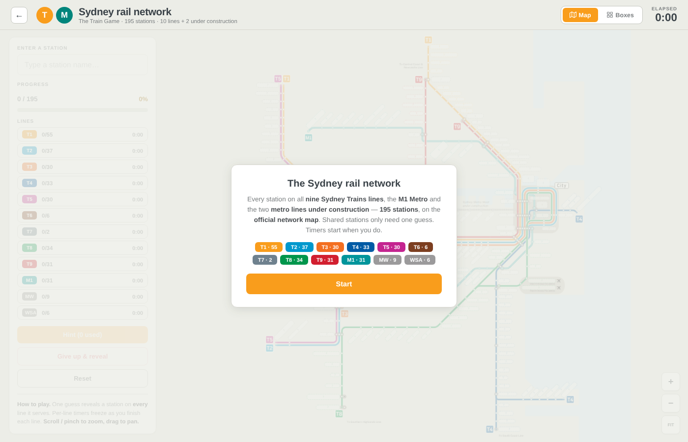

# Quizzes

JetPunk-style browser quizzes, led by **The Train Game**: name every station on the Sydney rail network.

**▶ Play:** https://jackbuzzie.github.io/quizzes/

## The Train Game

- **195 stations** across all nine Sydney Trains lines, the M1 Metro, and the two metro lines under construction, drawn on the network map
- One guess reveals a station on every line it serves
- Per-line timers that freeze as each line is completed
- Zoomable, pannable SVG map, plus a "Boxes" list view
- Hints, give-up/reveal, and a results screen

## Also in the collection

- **Taylor Swift Discography Quiz:** name as many tracks as you can from her studio albums against the clock
- **Blue Mountains Suburbs Quiz:** name every suburb along the Great Western Highway, east to west
- **Northern Beaches Quiz:** name every major ocean beach on the peninsula, north to south

## Tech

Each quiz is a single self-contained HTML file using vanilla JavaScript, inline SVG, and CSS. There are no frameworks or build step; `index.html` is the hub page.

It's a personal side project. The Train Game went through several versions (1.0 → 4.0), growing from a plain list into a full interactive network map.
